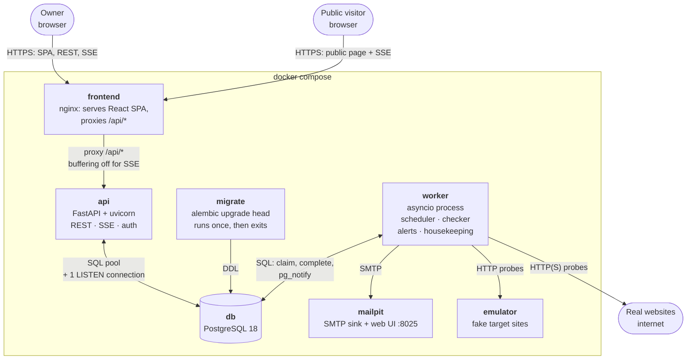
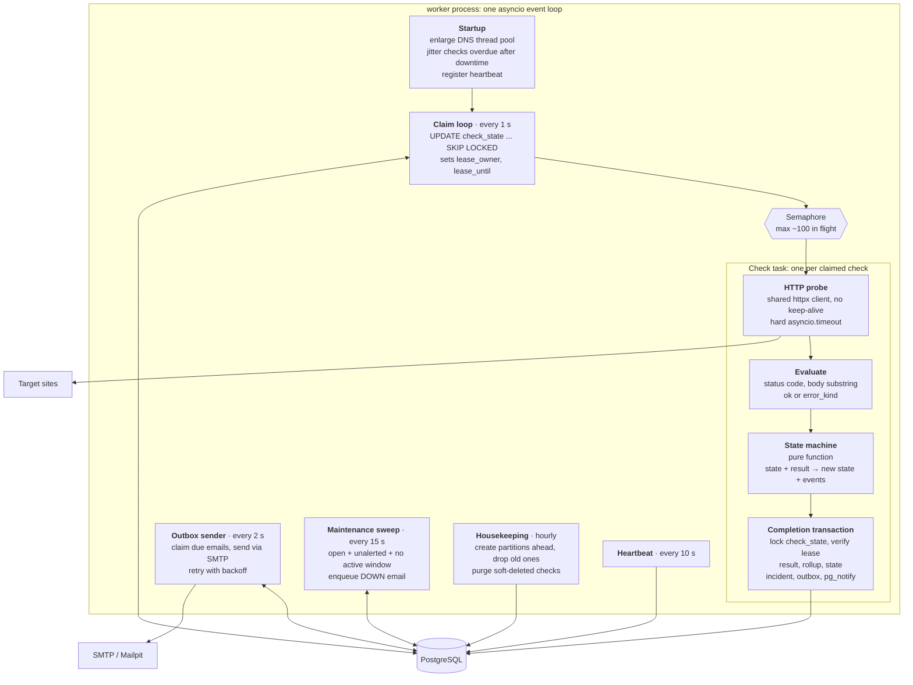

# Architecture

## Container diagram

Every box is one service in `docker-compose.yml`. Each arrow is labelled with
what travels over it.

Reviewers read the alert emails in Mailpit's web UI (:8025) and flip the
emulator's targets between healthy, slow, erroring and hanging through its
control endpoint, so they can watch a site go down and recover live.

**Startup order:** `db` (healthcheck) → `migrate` (must complete successfully)
→ `api` and `worker` → `frontend`.

**Key properties:**
- **The API never runs checks; the worker never serves HTTP.** A slow site or a
  burst of checks can't slow down the UI.
- **The database is the only shared state.** API and worker processes are
  stateless, so each can be scaled: `docker compose up --scale worker=3`.
- **Same origin for the browser:** nginx serves the SPA and proxies `/api`, so
  there is no CORS and the auth cookie just works.
- **Realtime path:** the worker commits with `pg_notify` → Postgres delivers to
  the API's LISTEN connection → the API pushes to browsers over SSE.

| Service | Port (host) | Notes |
|---|---|---|
| frontend | 8080 | the only port reviewers need |
| api | (internal) 8000 | expose it in dev for `/docs` |
| db | (internal) 5432 | expose it in dev for psql |
| mailpit | 8025 (UI), internal 1025 (SMTP) | |
| emulator | (internal) 9000 | expose it for the control endpoint |

## Worker internals

One process, one asyncio event loop. Each box is a long-running asyncio task.
They coordinate **only through the database**, never through in-memory state,
which is what makes running N workers safe.

| Task | Runs | Reads | Writes | Why it's separate |
|---|---|---|---|---|
| Claim loop | every 1 s | due, unleased, active checks | lease on `check_state` | one cheap query per tick, whatever the number of checks |
| Check task | per claim | target site | everything in the completion tx | a slow site only blocks its own task |
| Outbox sender | every 2 s | `notifications` due | status, attempts | a slow SMTP server never delays checks |
| Maintenance sweep | every 15 s | open unalerted incidents, windows | outbox rows, `down_alert_queued` | window end is a time event, not a check result |
| Housekeeping | hourly | partition list, soft-deleted checks | partitions, hard deletes | heavy and rare |
| Heartbeat | every 10 s | none | `worker_heartbeats` | lets the UI mark "monitoring was offline" |

**Shared inside the process:** one `httpx.AsyncClient`, one SQLAlchemy async
engine (asyncpg driver), the semaphore, and the enlarged default thread pool
used for DNS lookups.

**Database access:** the API uses the SQLAlchemy ORM for CRUD. The worker's hot
paths (claim, completion transaction, sweep) use SQLAlchemy Core with explicit
SQL. The API's LISTEN connection is a raw asyncpg connection.

**Graceful shutdown (SIGTERM):** stop claiming, wait up to about 10 s for
in-flight checks, then exit. Leases on anything unfinished simply expire.

**Lock-order rule:** every transaction that changes a check's runtime state
(completion, pause, delete, sweep) locks that check's `check_state` row
**first**. With a single order everywhere there are no deadlocks, and every
decision is made on the latest committed state. The sweep uses `SKIP LOCKED`,
so it never waits: it just retries the check next round.
