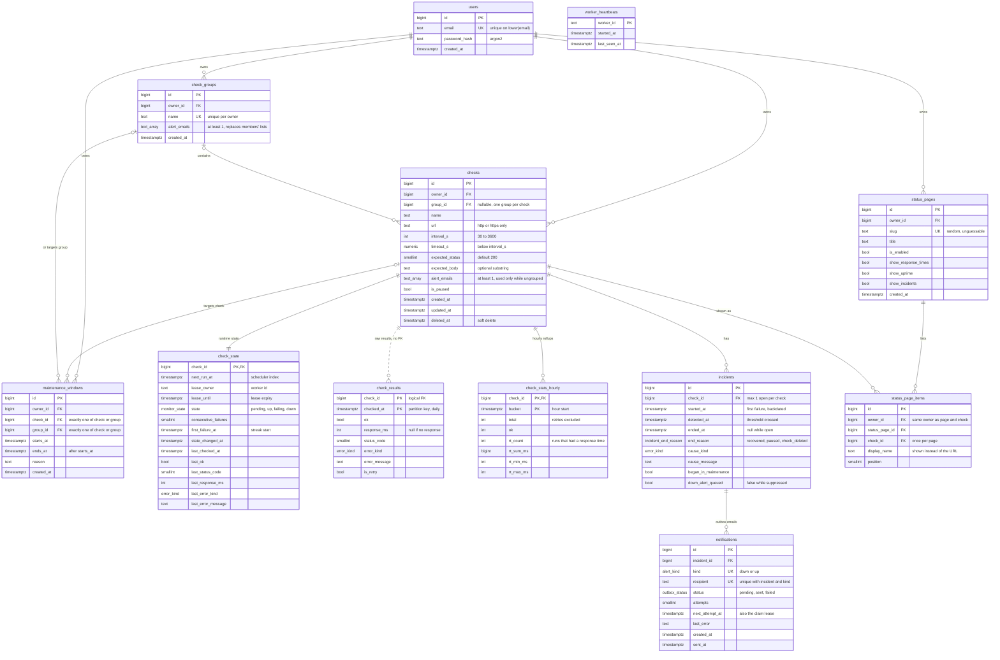

# Data model

Generated from `schema.sql`. Solid lines are real foreign keys. The **dashed**
line (`checks` to `check_results`) is a logical link with **no foreign key**,
on purpose: raw results are removed by dropping daily partitions, not by
cascading deletes.

## ERD

`worker_heartbeats` stands alone: it describes the monitor's own workers, not
user data. `text_array` in the diagram is `text[]` in SQL (Mermaid doesn't
accept brackets in type names).

## Tables at a glance

| Table | Written by | Growth | Purpose |
|---|---|---|---|
| `users` | API | per sign-up | accounts |
| `check_groups` | API | small | grouping, alert emails |
| `checks` | API | small | **configuration** the user edits |
| `check_state` | worker (+ API for pause/resume/run) | 1 row per check, updated every run | **runtime**: schedule, lease, current status. The dashboard reads only this. |
| `check_results` | worker | **2,880 rows/check/day** | raw history, partitioned by day, kept ~7 days |
| `check_stats_hourly` | worker | 720 rows/check/month | week/month charts and uptime % |
| `incidents` | worker (+ API on pause/delete) | per outage | incident log |
| `notifications` | worker | per alert email | transactional outbox |
| `maintenance_windows` | API | small | planned work |
| `status_pages`, `status_page_items` | API | small | public pages |
| `worker_heartbeats` | worker | 1 row per worker | monitor liveness |

## Enums

| Type | Values |
|---|---|
| `monitor_state` | `pending`, `up`, `failing`, `down` |
| `error_kind` | `timeout`, `dns`, `connect`, `tls`, `status_mismatch`, `body_mismatch`, `too_large`, `other` |
| `incident_end_reason` | `recovered`, `paused`, `check_deleted` |
| `alert_kind` | `down`, `up` |
| `outbox_status` | `pending`, `sent`, `failed` |

## Rules the ERD can't show

**Tenant isolation, enforced by the database:**
- Every owned table has `owner_id`. Links between owned tables are **composite
  foreign keys** on `(x_id, owner_id)`, so a row can only point at an object
  with the **same owner**. User A's check can't be put in user B's group, or
  on B's status page.
- Deleting a group sets only `checks.group_id` to null (`ON DELETE SET NULL (group_id)`), never `owner_id`.

**Uniqueness that encodes a business rule:**
- `incidents`: a partial unique index on `check_id WHERE ended_at IS NULL`, so
  **at most one open incident per check**.
- `notifications`: `UNIQUE (incident_id, kind, recipient)`, so **no duplicate
  email rows**.
- `status_page_items`: `UNIQUE (status_page_id, check_id)`.

**Check constraints:**
- `checks`: `interval_s` 30–3600, `timeout_s < interval_s`, `expected_status` 100–599, URL starts with http(s).
- `checks`, `check_groups`: `alert_emails` has at least one entry.
- `incidents`: `ended_at` and `end_reason` are both null or both set; `ended_at >= started_at`.
- `maintenance_windows`: exactly one of `check_id` / `group_id`; `ends_at > starts_at`.

**Physical design:**
- `check_results` is **partitioned by day**, with a `DEFAULT` partition as a
  safety net. Its primary key `(check_id, checked_at) INCLUDE (ok, response_ms)`
  makes day-view reads index-only.
- `check_state` uses `fillfactor = 70` to leave room on each page for frequent updates.
- Indexes: `check_state(next_run_at)` for the scheduler; partial indexes for
  due outbox rows and open, unalerted incidents; `incidents(check_id, started_at DESC)` for the log.
