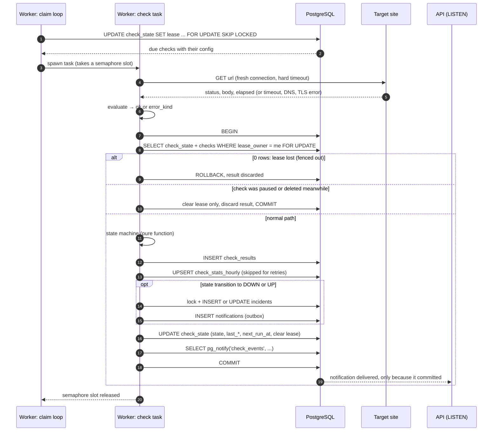
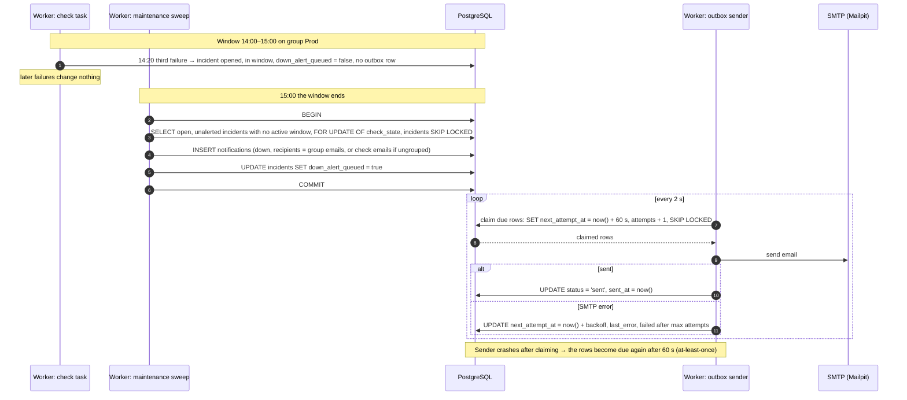
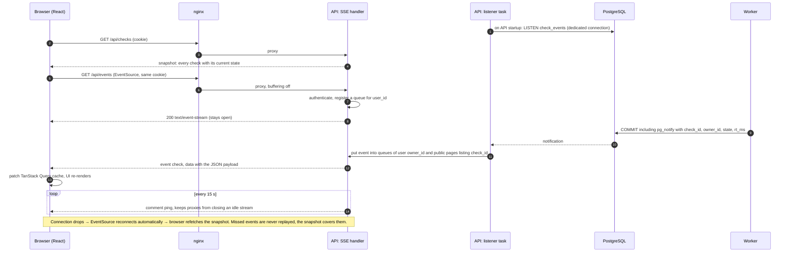
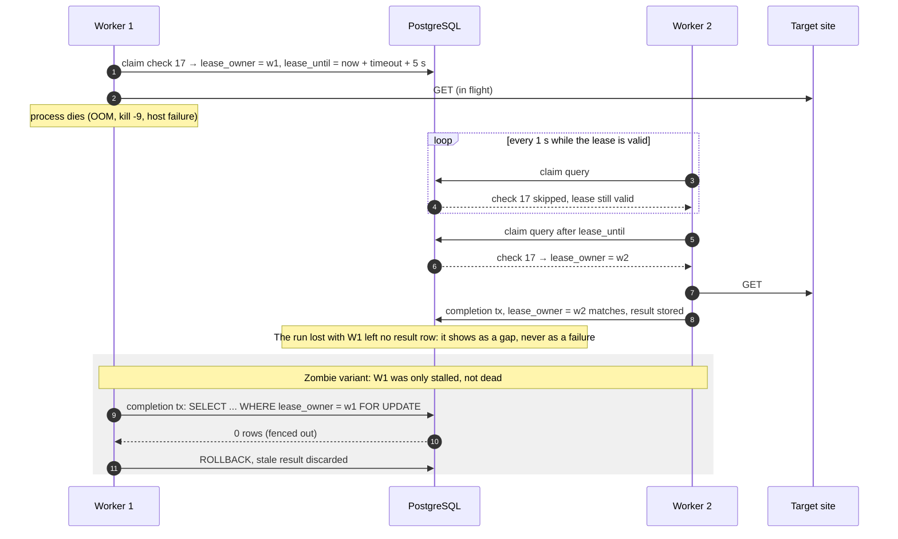
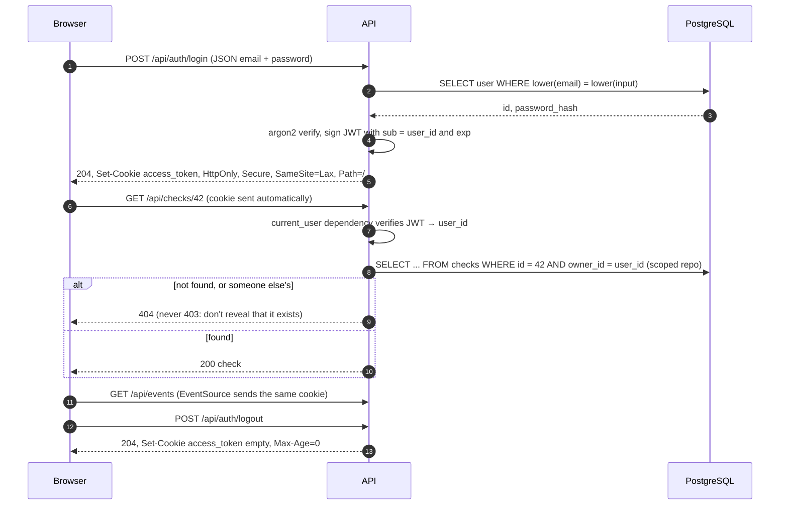
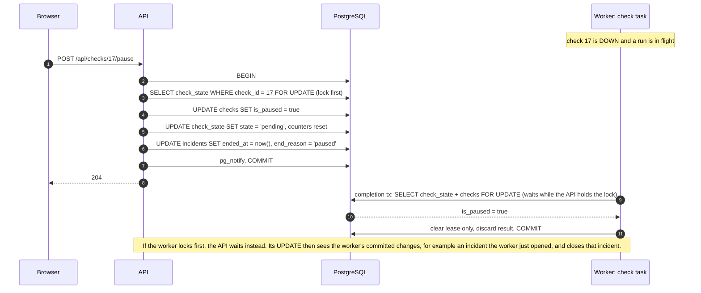

# Sequence diagrams

The key flows, step by step. Each one shows **who talks to whom, in which
order, and inside which transaction**.

---

## (a) One check run

**Why it's built this way:**
- The HTTP call happens **outside** any transaction. A 10 s timeout never holds
  a database connection or a lock.
- Everything the run changes is in **one transaction**. A crash leaves either
  all of it or none of it: never a result without a state update, or an
  incident without its email row.
- `next_run_at` is computed at completion (anchored to the schedule, or a
  retry time), so a check can never be claimed again while it's running.

---

## (b) Maintenance window ends while the site is still down

**Why the sweep locks `check_state` with `SKIP LOCKED`:** without it, this race
is possible. The sweep queues the DOWN email at the same moment a check task
closes the incident on recovery. The task sees `down_alert_queued = false` and
sends no UP email, so the user receives DOWN and never UP. With the lock,
whichever transaction goes second sees the other's committed result.

---

## (c) Realtime dashboard

**Notes:**
- The payload carries `owner_id`, so the listener can route events without a
  database query.
- A public page's stream is filtered by the set of `check_id`s that page lists,
  loaded when the stream connects. Changes to the page config apply on reconnect.
- "How long has it been down" is computed in the browser from the incident's
  `started_at`. The server doesn't tick it.

---

## (d) Worker crash: the lease expires and another worker takes over

A **zombie** can't actually outlive its lease, because the hard
`asyncio.timeout` (= the check's timeout) is shorter than the lease
(timeout + 5 s). The fencing check is the second line of defence, for cases
like the event loop being blocked.

---

## (e) Login and authenticated requests

**Notes:**
- **CSRF:** `SameSite=Lax` stops the cookie being sent on cross-site POSTs. The
  API also accepts only JSON request bodies on changing requests, and a
  cross-site HTML form can't send JSON.
- **`Secure` over plain http on localhost** works, because browsers treat
  localhost as a secure context. Make it configurable with `COOKIE_SECURE`.
- **Trade-off:** a stateless JWT can't be revoked before it expires. Logout only
  clears the cookie. Keep the expiry short-ish (for example 24 h) and document it.

---

## (f) Pause while a run is in flight: the lock-order rule

**Why it's correct either way round:** both sides lock the same row first, so
one transaction always runs completely before the other. Whichever goes second
works from the other's committed result.
