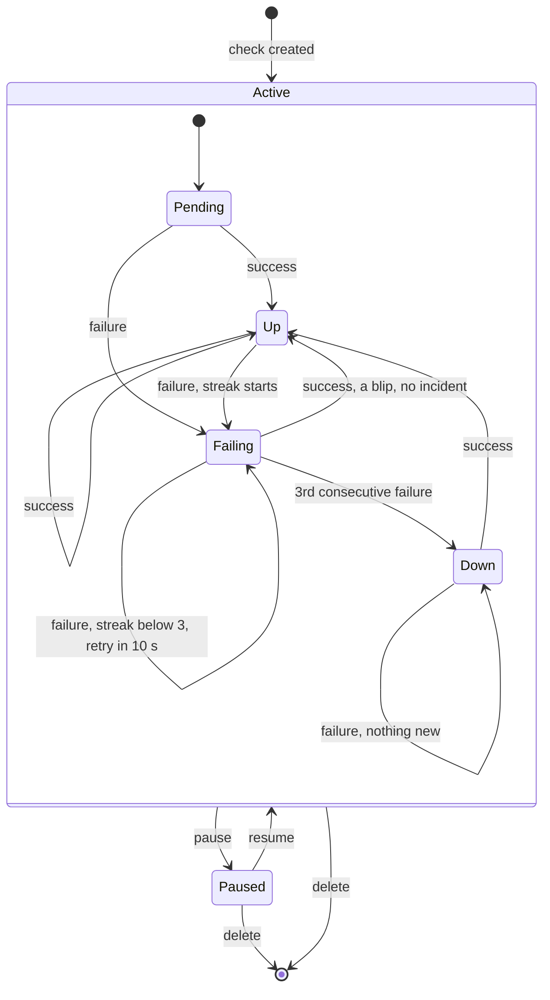

# Check state machine

This defines **when an incident opens, when it closes, and when an email is
sent**. It's implemented as a pure function
`(state, counters, result) -> (new_state, events)` and unit-tested in isolation.

## Diagram

`Paused` isn't a stored state value. It's `checks.is_paused = true` with
`check_state.state = 'pending'`. Maintenance isn't a state either: it only
changes whether emails are sent.

## Constants

| Name | Value | Meaning |
|---|---|---|
| `FAIL_THRESHOLD` | 3 | consecutive failed runs before DOWN (the 1st failure + 2 confirmation retries) |
| `RETRY_DELAY` | 10 s (or the interval, if shorter) | spacing of confirmation retries |
| Recovery | 1 success | one good run closes the incident |

So confirming DOWN takes 3 probes plus 2 retry gaps, whatever the interval
(30 s or 1 h). Each gap starts when the previous probe ends, so the time from
the first probe to DOWN is about `20 s + 3 × probe duration`: ~20 s for a fast
error (503, connection refused), ~50 s for a site that hangs until a 10 s
timeout. The API caps `timeout_s` at 30 s, so it is never more than ~2 min.

## Transitions and side effects

| From | Event | To | Side effects |
|---|---|---|---|
| Pending / Up | failure | Failing | `consecutive_failures = 1`, `first_failure_at = run time`, next run = now + `RETRY_DELAY` |
| Failing | failure, count below 3 | Failing | count + 1, next run = now + `RETRY_DELAY` |
| Failing | success | Up | count = 0. **No incident, no email.** |
| Failing | 3rd failure | Down | **open incident** (`started_at = first_failure_at`, `detected_at = now`). Not in maintenance: **enqueue DOWN email**, `down_alert_queued = true`. In maintenance: no email, `began_in_maintenance = true`. Next run on the normal schedule. |
| Down | failure | Down | nothing new, no email |
| Down | success | Up | **close incident**, `end_reason = 'recovered'`. **Enqueue UP email if and only if `down_alert_queued = true`.** |
| any | pause | Paused | close an open incident with `end_reason = 'paused'`, **no UP email**, counters reset |
| Paused | resume | Pending | `next_run_at = now`, a fresh start |
| any | delete | (gone) | soft delete, close an open incident with `end_reason = 'check_deleted'`, no email |
| any | config edited | unchanged | state is kept; the next run uses the new config and decides |

Not a transition, but part of the same rules: the **maintenance sweep**. An
open incident with `down_alert_queued = false` and no active window means the
window has ended while the site is still down, so it **enqueues the DOWN email**
and sets `down_alert_queued = true`.

## Email rules in one place

1. A DOWN email is sent **once per incident**: when the threshold is crossed,
   or when the maintenance window ends if it was suppressed.
2. An UP email is sent **only if a DOWN email was sent** for that incident, and
   only when the incident ends because the site recovered.
3. Between DOWN and UP, **nothing**, however many runs fail.
4. Maintenance suppresses DOWN emails only. A recovery during a window still
   sends UP if a DOWN was sent before the window started.
5. Recipients: a check **in a group** alerts the **group's** `alert_emails`,
   which replace the check's own list. An **ungrouped** check alerts its own
   list. Recipients are resolved when the email is enqueued.

## Behaviour to document for users

These are deliberate choices. Explain them in the README and in UI hints:

- **Pausing a check that is down ends its incident.** You won't get a
  "recovered" email for it. Resuming starts fresh.
- **Editing a check that is down keeps it down** until a run with the new
  settings succeeds. If your edit fixes the problem, you'll get the
  "recovered" email.
- **Group maintenance windows follow the group's current members.** Moving a
  check into a group under maintenance silences it; moving it out stops
  silencing it immediately.
- **A group's alert emails replace the check's own.** While a check is in a
  group, its own email list is ignored; it applies again if the check leaves
  the group. *UI:* on the check form, when a group is selected, grey out the
  check's email field and show "Alerts go to group *Prod*: a@x.com, ops@x.com.
  This check's emails are used only when it isn't in a group." The check list
  and check detail page show the effective recipients.
- **Downtime during maintenance still counts against uptime %.**
- **A restart of the monitor itself is a gap, not downtime.** Runs missed while
  the monitor was down are never replayed or counted.
